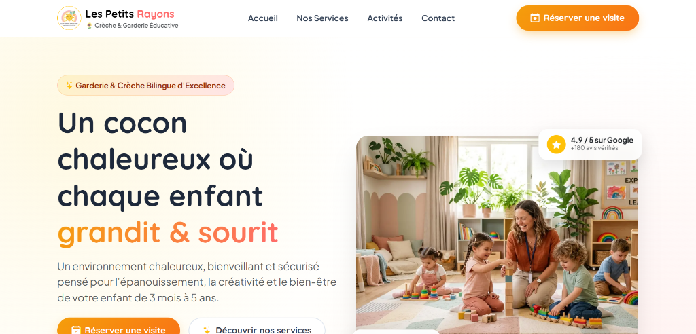
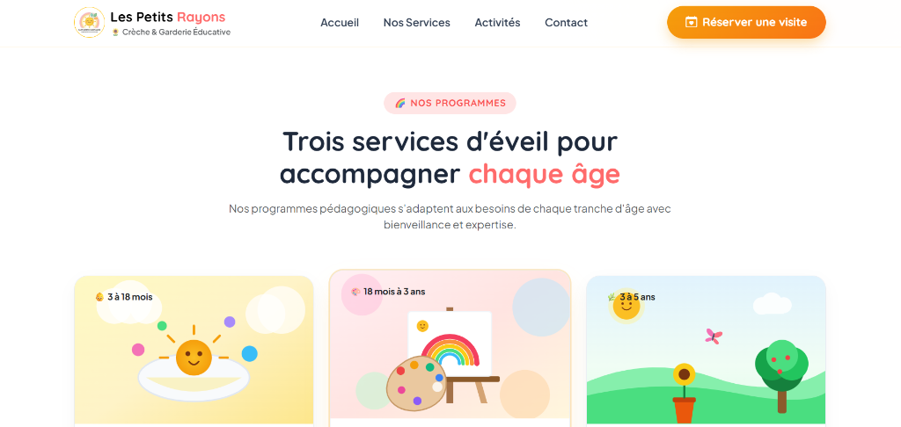
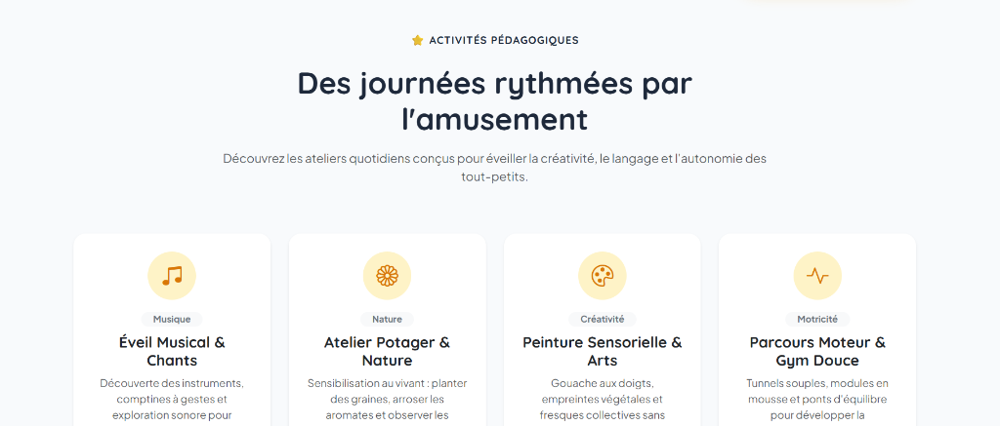
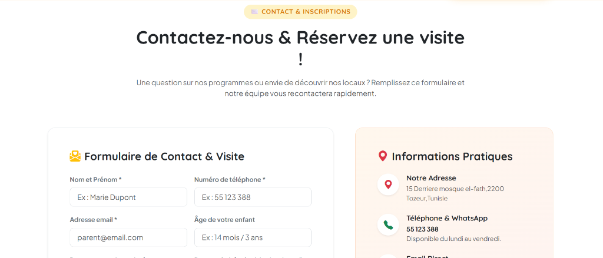

# 🌻 Garderie "Les Petits Rayons" - Application Web & API REST

Application web moderne et responsive pour la garderie et crèche d'enfants **"Les Petits Rayons"**, développée avec **Next.js 16**, **React 19**, **Bootstrap 5**, et un backend **Node.js / Express**.

---

## 📋 Table des matières

1. [Aperçu de l'application](#-aperçu-de-lapplication-captures-décran)
2. [Présentation du projet](#-présentation-du-projet)
3. [Fonctionnalités](#-fonctionnalités)
4. [Technologies utilisées](#-technologies-utilisées)
5. [Structure des dossiers](#-structure-des-dossiers)
6. [Historique des branches Git](#-historique-des-branches-git)
7. [Installation et exécution](#-installation-et-exécution)
8. [Documentation des API REST](#-documentation-des-api-rest)
9. [Auteur](#-auteur)

---

## 📸 Aperçu de l'application (Captures d'écran)

### 1. Barre de navigation & Section Hero
Interface d'accueil chaleureuse avec logo, menu de navigation responsive, titre d'accroche percutant, badges de réassurance et boutons d'appel à l'action.


---

### 2. Programmes d'éveil & Services (Cartes Bootstrap)
Présentation des 3 programmes adaptés par tranche d'âge sous forme de cartes Bootstrap interactives (effets de survol, badges colorés et points forts pédagogiques).


---

### 3. Activités pédagogiques quotidiennes (API Express dynamique)
Grille des activités et ateliers pour enfants chargés dynamiquement depuis la route `GET /api/activites` du backend Express.


---

### 4. Formulaire de contact & Informations pratiques
Formulaire complet pour les prises de contact et réservations de visite, accompagné des coordonnées pratiques dynamiques (`GET /api/garderie`).


---

## 🌟 Présentation du projet

**Garderie "Les Petits Rayons"** est une plateforme web conçue pour présenter les services, les activités et les valeurs d'une structure d'accueil de la petite enfance (enfants de 3 mois à 6 ans).

Le projet a été développé selon une démarche rigoureuse en plusieurs étapes :
1. Développement initial de la landing page responsive complète dans un seul fichier avec **Bootstrap 5**.
2. Découpage et modularisation en composants réutilisables (**Navbar**, **Hero**, **Services**).
3. Développement d'un serveur backend **Node.js / Express** exposant trois routes d'API REST.
4. Intégration dynamique des données de l'API dans les composants React du frontend.
5. Ajout d'un formulaire interactif de contact et de réservation de visite.

---

## ✨ Fonctionnalités

- **Navbar Responsive** : Logo, identité visuelle de la garderie, menu de navigation avec ancres et bouton d'action (CTA), menu burger tactile pour mobiles.
- **Section Hero** : Titre d'accroche percutant, description bienveillante, illustration animée, badges de confiance et boutons d'appel à l'action.
- **Section Services (Cartes Bootstrap)** : 3 programmes d'éveil adaptés par tranche d'âge présentés sous forme de cartes Bootstrap interactives :
  - *Crèche Douceur & Éveil Sensoriel* (3 à 18 mois)
  - *Ateliers Créatifs & Langage* (18 mois à 3 ans)
  - *Découverte & Plein Air* (3 à 5 ans)
- **Section Activités Pédagogiques** : Grille dynamique des ateliers quotidiens (*Éveil Musical*, *Potager & Nature*, *Peinture & Arts*, *Parcours Moteur*).
- **Formulaire de Contact & Visite** : Formulaire interactif (nom, téléphone, email, âge de l'enfant, service souhaité, date, message) avec confirmation de soumission.
- **Informations Pratiques Dynamiques** : Coordonnées, téléphone, email et horaires alimentés en temps réel par l'API Express.
- **Design Responsive** : Optimisé pour smartphones, tablettes et ordinateurs de bureau grâce à la grille Bootstrap 5 et aux styles personnalisés.

---

## 🛠️ Technologies utilisées

### Frontend
- **Framework** : [Next.js 16](https://nextjs.org/) (App Router, Turbopack)
- **Bibliothèque UI** : [React 19](https://react.dev/)
- **Langage** : [TypeScript](https://www.typescriptlang.org/)
- **Design & Styles** : [Bootstrap 5.3](https://getbootstrap.com/), [Bootstrap Icons](https://icons.getbootstrap.com/), Vanilla CSS (Design Tokens, variables HSL)
- **Polices** : Google Fonts (*Quicksand* & *Plus Jakarta Sans*)

### Backend
- **Environnement** : [Node.js](https://nodejs.org/)
- **Framework Web** : [Express 5](https://expressjs.com/)
- **CORS** : [cors](https://www.npmjs.com/package/cors)
- **Outil d'exécution simultanée** : [concurrently](https://www.npmjs.com/package/concurrently)

---

## 📁 Structure des dossiers

```text
garderie-app/
├── docs/                       # Documentation et captures d'écran
│   └── screenshots/            # Captures d'écran de l'application
│       ├── 01-hero-navbar.png
│       ├── 02-services.png
│       ├── 03-activites.png
│       └── 04-contact-form.png
├── public/                     # Fichiers statiques et médias
│   └── images/                 # Logos, bannières et illustrations SVG/JPG
│       ├── logo.jpg
│       ├── hero-banner.jpg
│       ├── hero-daycare.jpg
│       ├── service-eveil.jpg
│       ├── service-eveil.svg
│       ├── service-arts.svg
│       └── service-nature.svg
├── server/                     # Serveur Backend Express
│   └── server.js               # API REST Express (port 5000)
├── src/
│   ├── app/                    # Next.js App Router
│   │   ├── globals.css         # Styles globaux, variables CSS & composants Bootstrap
│   │   ├── layout.tsx          # Layout racine (Bootstrap, polices Quicksand/Plus Jakarta)
│   │   └── page.tsx            # Page d'accueil principale
│   ├── components/             # Composants indépendants
│   │   ├── Navbar.tsx          # Barre de navigation responsive
│   │   ├── Hero.tsx            # Section Hero avec bannière et CTA
│   │   ├── Services.tsx        # Section Services (3 cartes Bootstrap)
│   │   ├── Activites.tsx       # Section Activités pédagogiques
│   │   └── BookingContact.tsx  # Formulaire de contact et panneau d'informations
│   ├── services/
│   │   └── api.ts              # Fonctions de communication avec l'API Express
│   └── types/
│       └── index.ts            # Interfaces TypeScript (GarderieInfo, ServiceItem, ActiviteItem)
├── package.json                # Dépendances et scripts npm
├── tsconfig.json               # Configuration TypeScript
├── next.config.ts              # Configuration Next.js (rewrites API proxy)
└── README.md                   # Documentation du projet
```

---

## 🌿 Historique des branches Git

Conformément aux exigences du projet, le cycle de vie git suit une stratégie de branches thématiques (`feature branches`) systématiquement fusionnées dans `main` :

| Branche | Description | Statut |
| :--- | :--- | :--- |
| `main` | Branche principale de production | Actif |
| `feature/landing-page` | Création initiale de la landing page responsive complète dans un seul fichier `page.tsx` avec Bootstrap 5 | Fusionnée dans `main` |
| `feature/components` | Extraction et modularisation en trois composants indépendants : `Navbar.tsx`, `Hero.tsx`, et `Services.tsx` | Fusionnée dans `main` |
| `feature/backend` | Création du serveur Node.js / Express exposant `/api/garderie`, `/api/services` et `/api/activites` | Fusionnée dans `main` |
| `feature/api-integration` | Raccordement dynamique des composants React du frontend aux API Express | Fusionnée dans `main` |
| `docs/readme` | Rédaction de la documentation complète du projet et intégration des captures | Fusionnée dans `main` |

---

## 🚀 Installation et exécution

### 1. Prérequis
- [Node.js](https://nodejs.org/) (version 18 ou supérieure recommandée)
- [Git](https://git-scm.com/)

### 2. Cloner le dépôt
```bash
git clone https://github.com/TahaKhelifi1/garderie-app.git
cd garderie-app
```

### 3. Installer les dépendances
```bash
npm install
```

### 4. Lancer l'application

#### Option A : Lancer le Backend et le Frontend en une seule commande (Recommandé)
```bash
npm run dev
```
*(ou `npm run dev:all`)*. Cette commande démarre simultanément le serveur Express sur `http://localhost:5000` et Next.js sur `http://localhost:3000`.

#### Option B : Lancer les services séparément
- **Serveur Backend Express** :
  ```bash
  npm run server
  ```
  Le backend démarre sur : [http://localhost:5000](http://localhost:5000)

- **Application Frontend Next.js** (dans un autre terminal) :
  ```bash
  npm run dev:frontend
  ```
  Le frontend est accessible sur : [http://localhost:3000](http://localhost:3000)

### 5. Compiler pour la production
```bash
npm run build
npm run start
```

---

## 📡 Documentation des API REST

Le backend Express expose les trois points de terminaison REST suivants sous le préfixe `/api` (port 5000) :

### 1. `GET /api/garderie`
Renvoie les informations générales et institutionnelles de la garderie.

- **URL** : `http://localhost:5000/api/garderie`
- **Méthode** : `GET`
- **Exemple de réponse JSON** :
```json
{
  "success": true,
  "data": {
    "nom": "Garderie Les Petits Rayons",
    "slogan": "Grandir, s'épanouir et sourire chaque jour",
    "description": "Un environnement chaleureux, bienveillant et sécurisé pensé pour l'épanouissement, la créativité et le bien-être de votre enfant de 3 mois à 5 ans.",
    "adresse": "15 Derriere mosque el-fath,2200 Tozeur,Tunisie",
    "telephone": "55 123 388",
    "email": "sissykids2050@gmail.com",
    "horaires": "Lundi – Vendredi : 7h30 – 18h30",
    "capacite": 35,
    "anneeFondation": 2018,
    "agrement": "Agréé PMI & CAF",
    "statistiques": [
      { "valeur": "98%", "label": "Parents satisfaits" },
      { "valeur": "12+", "label": "Éducatrices qualifiées" },
      { "valeur": "100%", "label": "Alimentation bio & locale" },
      { "valeur": "6 ans", "label": "D'expérience & d'amour" }
    ]
  }
}
```

---

### 2. `GET /api/services`
Renvoie la liste des 3 services principaux proposés sous forme de cartes d'éveil.

- **URL** : `http://localhost:5000/api/services`
- **Méthode** : `GET`
- **Exemple de réponse JSON** :
```json
{
  "success": true,
  "data": [
    {
      "id": "eveil",
      "title": "Crèche Douceur & Éveil Sensoriel",
      "badge": "👶 3 à 18 mois",
      "badgeClass": "badge-soft-warning",
      "description": "Un cocon chaleureux avec un rythme personnalisé pour chaque bébé, des espaces moteurs doux et des professionnelles de la petite enfance dévouées.",
      "image": "/images/service-eveil.svg",
      "features": [
        "Espace snoezelen & stimulation sensorielle",
        "Taux d'encadrement renforcé (1 pour 3)",
        "Repas bio adaptés au rythme de diversification"
      ]
    },
    {
      "id": "arts",
      "title": "Ateliers Créatifs & Langage",
      "badge": "🎨 18 mois à 3 ans",
      "badgeClass": "badge-soft-coral",
      "description": "Peinture tactile, pâte à modeler végétale, éveil musical et comptines bilingues pour stimuler l'imagination, l'expression et la curiosité.",
      "image": "/images/service-arts.svg",
      "features": [
        "Éveil musical et rythmique quotidien",
        "Sensibilisation douce à l'anglais",
        "Développement de la motricité fine"
      ]
    },
    {
      "id": "nature",
      "title": "Découverte & Plein Air",
      "badge": "🌿 3 à 5 ans",
      "badgeClass": "badge-soft-teal",
      "description": "Jardin pédagogique, potager bio, motricité en extérieur et jeux coopératifs pour apprendre le vivre-ensemble et respecter la nature.",
      "image": "/images/service-nature.svg",
      "features": [
        "Sorties quotidiennes au jardin sécurisé",
        "Mini-potager et compostage ludique",
        "Jeux coopératifs et autonomie montessorienne"
      ]
    }
  ]
}
```

---

### 3. `GET /api/activites`
Renvoie la liste des activités destinées aux enfants au quotidien.

- **URL** : `http://localhost:5000/api/activites`
- **Méthode** : `GET`
- **Exemple de réponse JSON** :
```json
{
  "success": true,
  "data": [
    {
      "id": 1,
      "titre": "Éveil Musical & Chants",
      "horaire": "Mardi & Jeudi à 10h00",
      "icone": "bi-music-note-beamed",
      "categorie": "Musique",
      "description": "Découverte des instruments, comptines à gestes et exploration sonore pour stimuler le langage et le rythme."
    },
    {
      "id": 2,
      "titre": "Atelier Potager & Nature",
      "horaire": "Mercredi matin à 09h30",
      "icone": "bi-flower1",
      "categorie": "Nature",
      "description": "Sensibilisation au vivant : planter des graines, arroser les aromates et observer les insectes du jardin."
    },
    {
      "id": 3,
      "titre": "Peinture Sensorielle & Arts",
      "horaire": "Lundi après-midi à 15h00",
      "icone": "bi-palette",
      "categorie": "Créativité",
      "description": "Gouache aux doigts, empreintes végétales et fresques collectives sans contrainte pour libérer la créativité."
    },
    {
      "id": 4,
      "titre": "Parcours Moteur & Gym Douce",
      "horaire": "Vendredi matin à 10h30",
      "icone": "bi-activity",
      "categorie": "Motricité",
      "description": "Tunnels souples, modules en mousse et ponts d'équilibre pour développer la coordination et la confiance corporelle."
    }
  ]
}
```

---

## 👩‍💻 Auteur

Projet réalisé dans le cadre du Master 1 - Développement Web & Mobile.
- Dépôt GitHub : [https://github.com/TahaKhelifi1/garderie-app](https://github.com/TahaKhelifi1/garderie-app)
